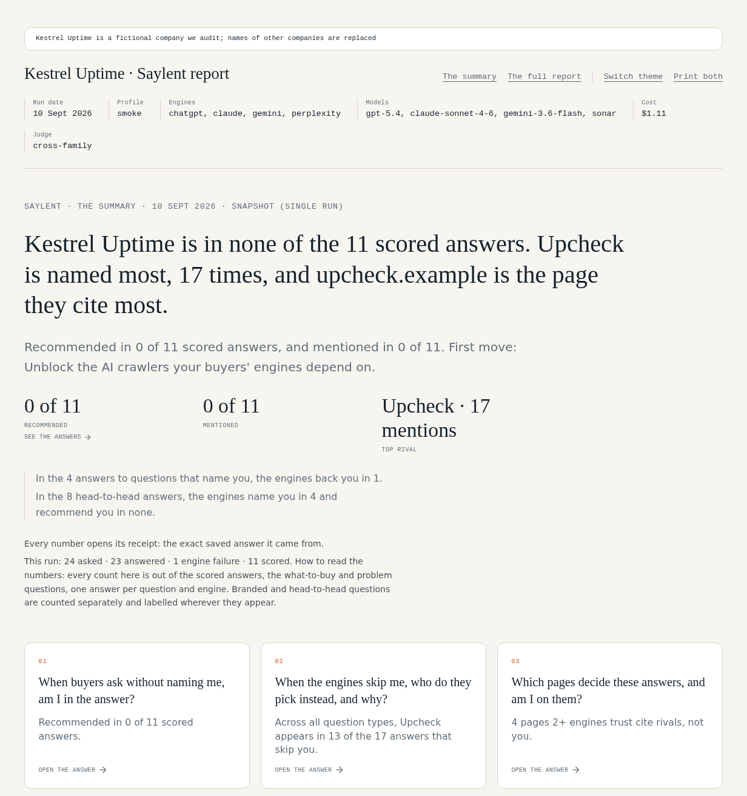
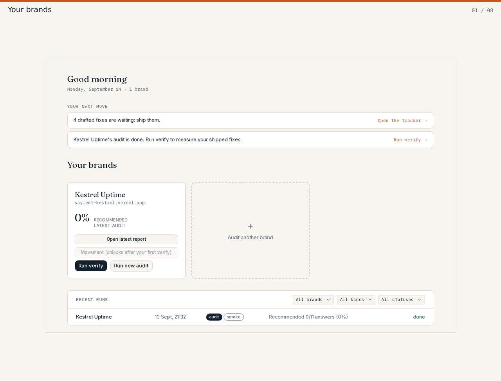
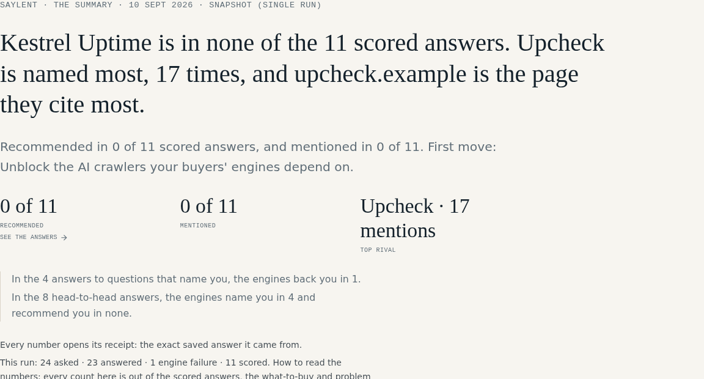
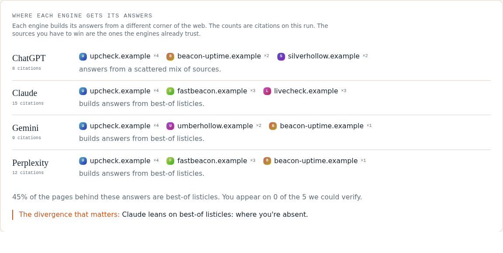
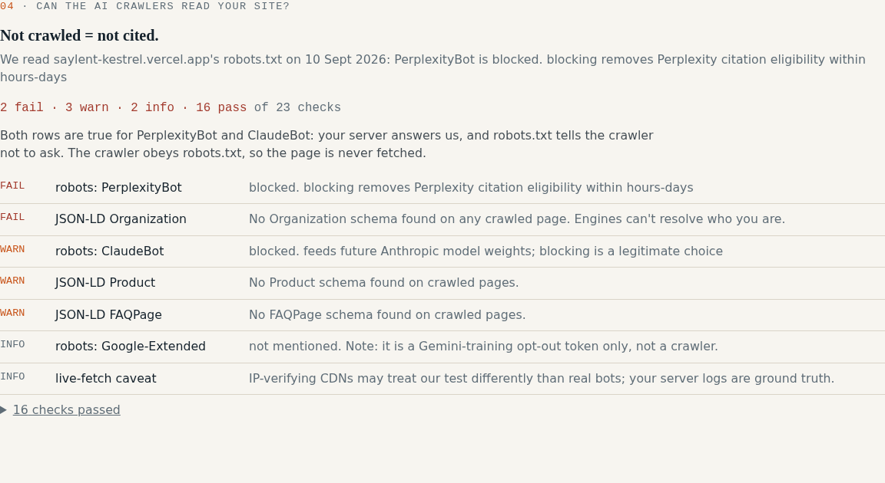
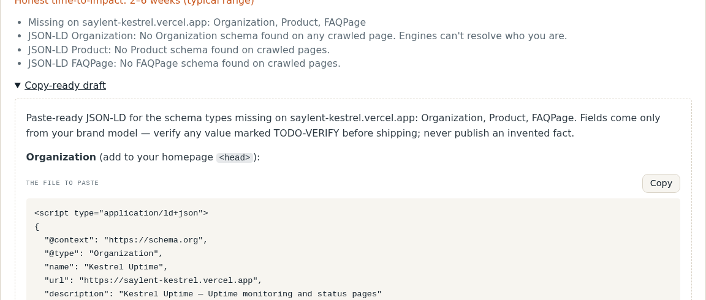
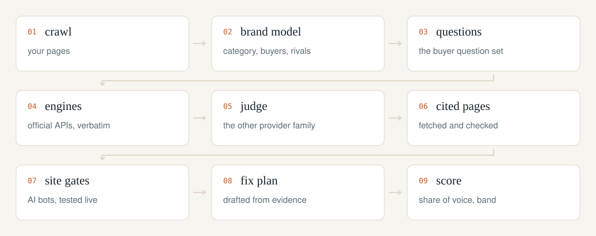

<p align="center">
  <picture>
    <source media="(prefers-color-scheme: dark)" srcset="https://raw.githubusercontent.com/yotambraun/saylent/main/website/public/brand/wordmark-dark.svg">
    
  </picture>
</p>

<p align="center">
  The open-source audit of what AI assistants say about your brand, with the receipts.
</p>

<p align="center">
  <a href="https://yotambraun.github.io/saylent/docs">Docs</a> ·
  <a href="https://yotambraun.github.io/saylent/docs/quickstart">Quickstart</a> ·
  <a href="https://yotambraun.github.io/saylent/samples/kestrel/report.html">Sample report</a> ·
  <a href="https://saylent-demo.vercel.app/app">Live demo</a>
</p>

<p align="center">
  <a href="https://github.com/yotambraun/saylent/actions/workflows/ci.yml"></a>
  <a href="https://www.npmjs.com/package/saylent"></a>
  <a href="https://www.npmjs.com/package/saylent"></a>
  <a href="https://www.npmjs.com/package/saylent"></a>
  <a href="LICENSE"></a>
</p>

Saylent asks ChatGPT, Claude, Gemini and Perplexity the questions your buyers
ask, records every answer and every page it cites, and turns what it finds into
the next thing to change on your site. Receipts, not scores: every count opens
the answer it came from. It runs on your own API keys, on your machine or your
own servers; nothing goes through us and there is no telemetry.

See a full report first. No key, no network, no cost:

```bash
npx saylent demo
```

<table>
  <tr>
    <td width="50%" align="center" valign="top">
      <a href="https://yotambraun.github.io/saylent/samples/kestrel/report.html"><picture>
        <source media="(prefers-color-scheme: dark)" srcset="https://raw.githubusercontent.com/yotambraun/saylent/main/website/public/media/hero-report-dark.png">
        
      </picture></a><br>
      <sub><b><a href="https://yotambraun.github.io/saylent/samples/kestrel/report.html">Open the full sample report</a></b>: a real run against Kestrel Uptime, a fictional company we audit. <a href="examples/kestrel/">(source: examples/kestrel)</a></sub>
    </td>
    <td width="50%" align="center" valign="top">
      <a href="https://saylent-demo.vercel.app/app"><picture>
        <source media="(prefers-color-scheme: dark)" srcset="https://raw.githubusercontent.com/yotambraun/saylent/main/website/public/media/app-dark.gif">
        
      </picture></a><br>
      <sub><b><a href="https://saylent-demo.vercel.app/app">Open the live demo</a></b>: the same run inside the app, with history, a fix tracker and share links. Nothing saves, no account.</sub>
    </td>
  </tr>
</table>

Then price a real audit of your own site before anything is sent, and run it:

```bash
npx saylent audit your-domain.com --dry-run
npx saylent audit your-domain.com
```

One `OPENAI_API_KEY` or `ANTHROPIC_API_KEY` runs it; both turn on the
cross-family judge, where one provider family judges the other's answers.
`GEMINI_API_KEY` and `PERPLEXITY_API_KEY` add those engines, and
`SERPAPI_API_KEY` adds the opt-in [answer surfaces](https://yotambraun.github.io/saylent/docs/surfaces). Export
them, put them in a `.env`, or run `saylent keys set openai`. With all four
engines a smoke run costs about **$0.80 to $1.20** of your own credits and a
full run about **$5.10 to $7.10**; our two recorded smoke runs cost $0.93 and
$1.11. `--dry-run` is free and `--max-usd 1` refuses to start above a cap.
Node 22 or newer, on macOS, Linux or Windows.

> **Which tool?** [promptbeacon](https://github.com/yotambraun/promptbeacon) is
> for developers and open-source maintainers: does AI recommend your library or
> dev product — a number in CI and a README badge. Saylent is for brand and
> website teams: an audit of what AI assistants say about your site, with the
> answers and cited pages as receipts, plus fixes for your site.

## What you get

| | What it does | Start |
|---|---|---|
| **Audit, with receipts** | Recommended, mentioned or absent per question and engine, who is named instead, every cited page, the web searches the engine ran where it reports them, and a fix plan drafted from your own evidence | `saylent audit` · [Quickstart](https://yotambraun.github.io/saylent/docs/quickstart) |
| **Answer surfaces** | Google AI Overviews, Google AI Mode and Microsoft Copilot, judged like any engine, through your own SerpApi key | `--surfaces` · [Surfaces](https://yotambraun.github.io/saylent/docs/surfaces) |
| **Sources & opportunities** | Which domains the answers cite, who they name, and the off-site pages where rivals are cited and you are not | `saylent sources` · [Sources](https://yotambraun.github.io/saylent/docs/sources) |
| **AI crawlers** | Which AI bots actually visit, from your own access log: what they fetch and what they are refused, and the visitors AI assistants sent | `saylent crawlers` · [AI crawlers](https://yotambraun.github.io/saylent/docs/crawlers) |
| **Site check** | What robots.txt says per AI bot and what a live fetch as each one gets, $0 and keyless, also as a GitHub Action | `saylent gate-check` · [Site check](https://yotambraun.github.io/saylent/docs/check) |
| **Real questions** | Your Search Console queries, a CSV or a list, turned into the questions an audit asks | `saylent questions import` · [Import](https://yotambraun.github.io/saylent/docs/import-questions) |
| **Verify and alerts** | Re-ask the same frozen questions after a fix; Slack, email or a signed webhook when answers move | `saylent verify --notify` · [Alerts](https://yotambraun.github.io/saylent/docs/alerts) |
| **Fixes to a pull request** | robots.txt and JSON-LD fixes written to a branch of your site repo with the receipts as the PR description; never pushed for you | `saylent fixes apply` · [CLI](https://yotambraun.github.io/saylent/docs/cli) |
| **Export and API** | Answers, citations, the engines' searches, sources, share of voice, fixes, crawler counts and AI referral visits as versioned CSV or JSON; a read-only API in the app | `saylent export` · [Export](https://yotambraun.github.io/saylent/docs/export) |
| **Agent-native** | An MCP server with ten tools and a Claude Code plugin that walks the whole loop, asking before it spends | `saylent mcp` · [MCP](https://yotambraun.github.io/saylent/docs/mcp) |
| **The app** | Brands, history, a fix tracker, share links and an operator console, on your own Supabase | [Deploy the app](https://yotambraun.github.io/saylent/docs/self-host) |

**Why this exists.**

- I cannot see what ChatGPT, Claude, Gemini and Perplexity tell my buyers about us.
- When a tool tells me I am invisible, I want the answer it read that from.
- I do not want a score. I want the next thing to change on my site.
- My API keys and my data should stay on my machine.
- I want the first result in about five minutes, without an account or a sales call.

## What a report shows

Every run writes `report.html` (self-contained, safe to email), `report.md`
and `run.json`, the lossless bundle every other command reads.

<table>
  <tr>
    <td width="50%" align="center" valign="top">
      <picture>
        <source media="(prefers-color-scheme: dark)" srcset="https://raw.githubusercontent.com/yotambraun/saylent/main/website/public/media/receipt-verdict-dark.png">
        
      </picture><br>
      <sub><b>Verdict.</b> What the engines actually recommend, as a count over the questions that were scored, never a single invented number.</sub>
    </td>
    <td width="50%" align="center" valign="top">
      <picture>
        <source media="(prefers-color-scheme: dark)" srcset="https://raw.githubusercontent.com/yotambraun/saylent/main/website/public/media/receipt-answer-dark.png">
        
      </picture><br>
      <sub><b>Receipt.</b> The exact answer, the engine, the date, and the pages that answer was built from.</sub>
    </td>
  </tr>
  <tr>
    <td width="50%" align="center" valign="top">
      <picture>
        <source media="(prefers-color-scheme: dark)" srcset="https://raw.githubusercontent.com/yotambraun/saylent/main/website/public/media/receipt-gate-dark.png">
        
      </picture><br>
      <sub><b>Gate.</b> Which AI bots your site lets in: what robots.txt says per bot, and what actually happens when we fetch a page as one.</sub>
    </td>
    <td width="50%" align="center" valign="top">
      <picture>
        <source media="(prefers-color-scheme: dark)" srcset="https://raw.githubusercontent.com/yotambraun/saylent/main/website/public/media/receipt-fix-dark.png">
        
      </picture><br>
      <sub><b>Fix.</b> Drafted from your own evidence and ready to paste: here, the Organization, Product and FAQPage JSON-LD the crawl found missing.</sub>
    </td>
  </tr>
</table>

## From your agent

```text
/plugin marketplace add yotambraun/saylent
/plugin install saylent@saylent
/saylent:ai-visibility-audit example.com
```

The Claude Code plugin adds the MCP server and six skills. The end-to-end one
prices the audit for free, asks, runs it, reads the sources and the
opportunities, lists the drafted fixes with their evidence and leaves you a
verify plan. Saylent measures and shows the receipts; your agent does the
reasoning. Any other MCP client (Claude Desktop, Cursor, VS Code, Windsurf,
Codex CLI, Gemini CLI) runs `npx -y saylent mcp`:
[setup for each](https://yotambraun.github.io/saylent/docs/mcp#connect-a-client). Keys are never pasted into a
chat: run `npx saylent keys set openai` in your own terminal once.

## The app

The same engine with a memory: history across runs, a fix tracker, rival
comparison, scheduled verifies, alerts, Export, a read-only API, and share
links for someone with no account. One deployment holds as many accounts as you
like, isolated by row-level security, with one operator who owns the keys, the
spend cap and the kill switch. Your own Supabase project, on any Node host,
Docker or Vercel. [The app, screen by screen](https://yotambraun.github.io/saylent/docs/tour) ·
[the live read-only demo](https://saylent-demo.vercel.app/app).

<p align="center">
  <a href="https://vercel.com/new/clone?repository-url=https%3A%2F%2Fgithub.com%2Fyotambraun%2Fsaylent&project-name=saylent&repository-name=saylent&env=NEXT_PUBLIC_APP_URL%2CNEXT_PUBLIC_SITE_URL%2CNEXT_PUBLIC_APP_NAME%2CNEXT_PUBLIC_SUPABASE_URL%2CNEXT_PUBLIC_SUPABASE_ANON_KEY%2CSUPABASE_SERVICE_ROLE_KEY%2CDATABASE_URL%2CDIRECT_DATABASE_URL%2COPENAI_API_KEY%2CANTHROPIC_API_KEY%2CINNGEST_EVENT_KEY%2CINNGEST_SIGNING_KEY&envDescription=Your%20own%20Supabase%20project%2C%20Inngest%20keys%20and%20LLM%20API%20keys%20-%20Saylent%20runs%20entirely%20on%20your%20accounts&envLink=https%3A%2F%2Fyotambraun.github.io%2Fsaylent%2Fdocs%2Fself-host%2Fenvironment"></a>
</p>

## How it works

<p align="center">
  <picture>
    <source media="(prefers-color-scheme: dark)" srcset="https://raw.githubusercontent.com/yotambraun/saylent/main/website/public/brand/pipeline-dark.svg">
    
  </picture>
</p>

We ask real buyer questions to real AI engines through their official APIs and
record every answer verbatim. Presence is a deterministic alias match; a judge
model from the other provider family decides the rest, quoting its reasoning
first. We fetch the pages an answer cites and check them for the same presence,
word match rather than entailment. We report a confidence band, never a single
fake-precise number. [How it works](https://yotambraun.github.io/saylent/docs/how-it-works) ·
[methodology](https://yotambraun.github.io/saylent/docs/methodology) · [architecture](ARCHITECTURE.md) ·
[what it costs](https://yotambraun.github.io/saylent/docs/costs) · [what gets sent to providers](https://yotambraun.github.io/saylent/docs/data-sent)

### What this does not tell you

- One run is a snapshot of the official API surface on one date. Consumer apps can answer differently. Google AI Overviews, Google AI Mode and Microsoft Copilot are measured only when you add them, as your SerpApi key reads them.
- Share of voice counts mentions in the answers we drew, not market share, and cited-page checks are word presence, not entailment.
- No traffic estimate, no revenue effect, no ranking claim, and no claim that a fix caused a movement. Movement after a fix is correlation.

[Compared with hosted tools](https://yotambraun.github.io/saylent/docs/compare): what they do that this does not, and
the other way round.

## Project

`npm install && npm test` runs the whole suite with no keys and no database.
An answer engine is one file implementing `Ask`; a site check is one registry
entry. Issues are triaged weekly by one maintainer; there is no support SLA.
[Contributing](https://yotambraun.github.io/saylent/docs/contributing) · [CONTRIBUTING.md](CONTRIBUTING.md) ·
[extending it](https://yotambraun.github.io/saylent/docs/extending) · [CHANGELOG.md](CHANGELOG.md) ·
[CODE_OF_CONDUCT.md](CODE_OF_CONDUCT.md). Security issues:
[SECURITY.md](SECURITY.md). Questions and ideas:
[Discussions](https://github.com/yotambraun/saylent/discussions). Licensed
under [Apache-2.0](LICENSE).

<sub>
Kestrel Uptime is a fictional company we built and audited for real, hosted at <code>saylent-kestrel.vercel.app</code> so the crawl, the robots.txt read and the live bot probes are genuine. Every other company and host in the sample is pseudonymized to a <code>.example</code> name. It is a brand nobody has heard of yet, so every count in it is zero, and that is the finding.
Read the whole run in <a href="examples/kestrel/">examples/kestrel</a>, or render it offline for $0 with <code>npx saylent demo</code>.
</sub>
